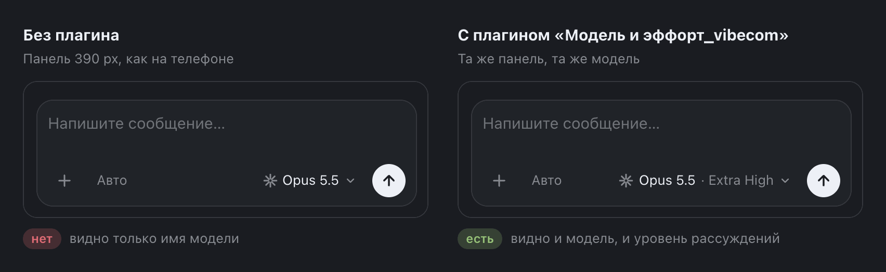

# Модель и эффорт_vibecom 0.1.0

Last Updated: 2026-10-30

Папка и id плагина — `composer-labels`; в интерфейсе BB он называется Модель и эффорт_vibecom.
Возвращает в чип набора у поля ввода уровень рассуждений (эффорт): `Sonnet 5.5 · Extra High` вместо
`Sonnet 5.5`. BB >= 0.46, SDK >= 0.6.37. Настроек нет, плагин ничего не хранит и не пишет в файлы.

Зачем. Чип набора умеет показывать и модель, и эффорт, но в узком поле ввода bb прячет эффорт
(ширина поля ввода 480 px и меньше). На телефоне поле ввода уже, поэтому эффорта там не видно никогда: в строке
остаётся только модель. Плагин показывает эффорт на любой ширине поля от 256 px; ниже чип в bb и так
сжимается до иконки, там решает bb. Эффорт сжимается последним: при нехватке места обрезается имя модели.
Провайдер неважен — правило общее для поля ввода.

Установка из Git:

```sh
bb plugin install "git:https://github.com/vibe-commerce-org/bb-vadim-setup.git@semver:~0.5.0" --subdirectory plugins/composer-labels
```

Локально, в этой папке: npm ci, bb plugin build ., bb plugin install . Тестов у плагина нет: вся работа —
стилевой лист `app.css`, а `app.tsx` лишь держит его подключённым.

Это временная поправка. Плагин опирается на внутреннюю разметку bb (атрибуты `data-promptbox-*` и имя
стилевого слоя `components`). Если после обновления bb эффорт на телефоне снова пропал, плагин можно
выключить (`bb plugin disable composer-labels`) или убрать (`bb plugin uninstall composer-labels`):
файлов и настроек он не трогает, откат ничего не ломает. Когда bb сам начнёт показывать эффорт в узком
поле ввода, плагин не нужен.

## Снимки

Иллюстрация на демо-данных: живой bb не снимался.



*Узкое поле ввода, как на телефоне: слева без плагина только «Opus 5.5», справа с плагином «Opus 5.5 · Extra High». Иллюстрация на демо-данных: разметка набора воссоздана, правило — настоящий `app.css` плагина.*
