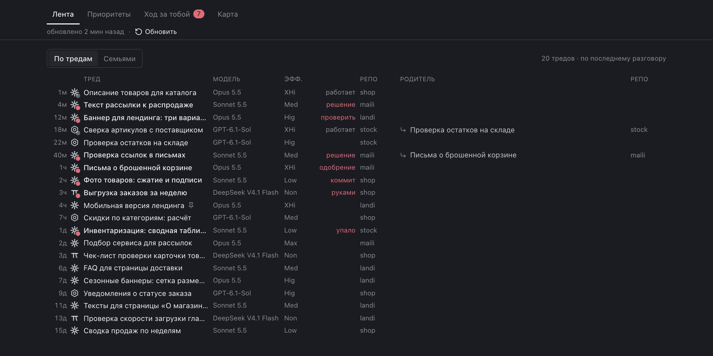
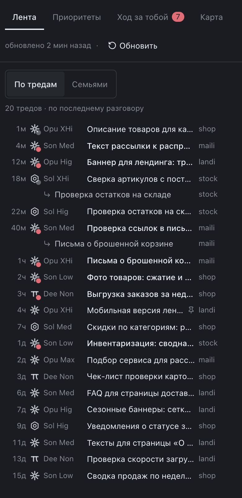
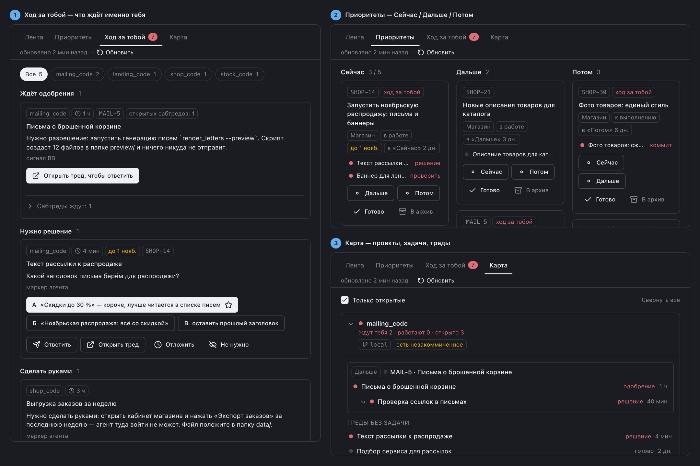

# Пульт_vibecom 0.4.4

Last Updated: 2026-10-30

Папка и id плагина — `pult`; в интерфейсе BB он называется Пульт_vibecom.
Страница «Пульт» в боковой панели отвечает на вопрос «чей ход» по всем тредам:

- **«Лента»** (открывается первой) — все активные треды, каждый своей строкой, самый свежий разговор сверху
  (по времени ответа агента или вашего сообщения). Таблица без линий: когда (`<1м`, `5м`, `3ч`, `2д`) ·
  логотип агента с точкой состояния (красная — ждёт вас, пульсирует — работает) · название · модель ·
  эффорт последнего хода (`Hig`, `XHi`, `Max`) · метка состояния («работает», «решение») · репозиторий
  (первые пять символов без `_code`, полное имя в подсказке) · родитель и его репозиторий. У сабтреда виден родитель; переключатель «По тредам / Семьями». На
  телефоне вместо колонок модели и эффорта — метка из трёх букв модели и эффорта перед названием. Только
  читает, в треды ничего не пишет; нужна, потому что встроенный список BB вкладывает сабтред в родителя;
- **«Приоритеты»** — задачи BB Tasks в полосах Сейчас / Дальше / Потом (лимит 5 в «Сейчас»),
  кнопки «Готово» и «В архив»;
- **«Ход за тобой»** — треды, где агент закончил ход и ждёт вас: подтверждение, решение (вопрос,
  варианты А/Б/В, план на «делай»), ручной шаг, ошибка, проверка результата, коммит;
- **«Карта»** — проекты, задачи и треды с родителями и детьми.

Те же вкладки — в правой панели («Пульт»), в треде ещё «Этот тред»; метки на строках тредов. Работает и в браузере телефона.
BB >= 0.46, SDK >= 0.6.37.

Версии: 0.4.4 — в «Ленте» колонки «Модель» и «Эфф.» стоят строго друг под другом (метка состояния — колонка
фиксированной ширины, значок закрепа рядом с названием); 0.4.3 и 0.4.2 — «Лента» с моделью, эффортом и иконками
агентов (отдельных выпусков не было). Известное ограничение: на ширине списка около 1000 px и уже названия в
«Ленте» короче (примерно 14–17 символов), от 1280 px потерь нет.

Установка из Git:

```sh
bb plugin install "git:https://github.com/vibe-commerce-org/bb-vadim-setup.git@semver:~0.5.0" --subdirectory plugins/pult
```

Локально, в этой папке: npm ci, bb plugin build ., bb plugin install .
Тесты: npm test (Node.js >= 22.18) — распознавание хода по тексту ответа, маркер, полосы, карта, база.
Команда для агентов: `bb pult queue`, `bb pult lanes`, `bb pult explain <id треда>`
(`skills/pult/SKILL.md`).

Ход Пульт распознаёт по тексту ответа агента, точнее всего — по строке-маркеру в конце ответа:

```text
⏸ Ход за тобой · решение · до 2026-10-25: выбрать тариф
Варианты: А — базовый; Б — расширенный (рекомендую)
```

Правило для агентов про маркер — в `instructions/AGENTS.md` комплекта, раздел «Ход за пользователем».
Ответить в тред можно только со страницы Пульта, вашим кликом: агенты через `bb pult` в треды не пишут.
Правила распознавания настроены на русские ответы агентов. Разбор спорных тредов моделью в этой сборке
отключён в коде: настройка `llmTriage` ничего не делает. Для «Карты» Пульт читает состояние git
репозиториев проектов (незакоммиченное, коммиты впереди удалённого).

## Снимки

Вымышленный магазин «Тест»: настоящие компоненты плагина в теме atom-one_vibecom на демо-данных, живой bb не снимался.



*«Лента» на десктопе: каждый тред — строка с агентом и состоянием, названием, моделью, эффортом, репозиторием и родителем сабтреда. Демо-данные.*



*«Лента» на телефоне: вместо колонок модели и эффорта — короткая метка у логотипа агента, родитель сабтреда — второй строкой. Демо-данные.*



*Пульт целиком на одном составном кадре: «Ход за тобой» (1), «Приоритеты» Сейчас / Дальше / Потом (2), «Карта» проектов (3). Демо-данные.*
